# 00 — The big picture: from laptop to iPhone

## 1. The idea

A web app is **files on a server plus data somewhere else**. The files (HTML, JavaScript, CSS) are the same for everyone and can be served by any "static" host. The data (who has which chore, who's done) is different per user, changes all the time and must be protected. That needs a database with logins and access rules.

So almost every small web app has the same shape:

- **Frontend**: the code that runs in the browser. You write it on your laptop, a *build* turns it into plain files, a *host* serves them.
- **Backend**: database + authentication + a bit of server code. Today you usually rent this as a service (Backend-as-a-Service) instead of running your own server.
- **Pipeline**: an automatic path from "I saved my code" to "it's live", so deploying is boring and repeatable.

Before writing code, professionals also write down **what the product is for**, because the hardest problem in a small app is building too much, not the code itself. That's product planning: one core value, a short list of phases, and a rule for when to stop.

## 2. In our app

```mermaid
flowchart LR
  laptop["Laptop: code in VS Code"] -->|"git push"| repo["GitHub repo peerboku/wehrgasse"]
  repo -->|"triggers"| actions["GitHub Actions: npm ci + npm run build"]
  actions -->|"uploads dist/"| pages["GitHub Pages: static files"]
  pages -->|"HTTPS"| phone["iPhone: Home-Screen app"]
  phone <-->|"login, read/write chores"| supa[("Supabase: Postgres + Auth")]
  supa -->|"webhook when done_at is set"| fn["Edge Function notify-done"]
  fn -->|"Web Push (VAPID)"| apns["Apple push service"]
  apns --> others["The other 3 iPhones"]
```

| Layer | What we use | Where it's configured |
|---|---|---|
| Frontend | Vite + React + TypeScript | [package.json](../../package.json), [vite.config.ts](../../vite.config.ts) |
| Host | GitHub Pages | repo Settings → Pages |
| Pipeline | GitHub Actions | [.github/workflows/deploy.yml](../../.github/workflows/deploy.yml) |
| Backend | Supabase (EU region) | [supabase/config.toml](../../supabase/config.toml) |
| Push | Web Push via Edge Function | Phase 4 |

**Product planning lives in two files:**

- [CLAUDE.md](../../CLAUDE.md) holds the *rules that don't change*: the core value ("open the app → see my chore → tap erledigt → the others get a push"), the domain rules (rotation table, week in Europe/Vienna), the stack and the definition of done.
- [ROADMAP.md](../../ROADMAP.md) holds the *order of work*: phases with a date each, a launch date (Mon 26.10.2026), success metrics measured from data, and a **kill rule** (done-rate < 50 % after 4 weeks → simplify or switch back to Flatastic).

The phases are ordered so the riskiest unknowns get tested earliest: a **clickable prototype on fake data** (Phase 1) is put in front of the flatmates (Phase 2) *before* the real database is built (Phase 3). Changing a screen is cheap; changing a database schema with real data in it is not.

## 3. Predict, then run

Open [ROADMAP.md](../../ROADMAP.md). Before reading the "Ideas" section, predict: which feature that Flatastic has (see screenshots in `docs/flatastic/screenshots/`) did we decide *not* to build for launch? Then check "After launch" and "Ideas".

## 4. What a pro would also do

- **Write the success metrics before building**, as we did, and also record the *baseline* now: count chore-related messages in the flat chat for the last 4 weeks *today*. Without the "before" number the "after" comparison in week 4 is guesswork.
- **Draw the system before coding** (the diagram above), and update it when it changes.
- **Name the riskiest assumption** and test it first. Here it is: "all 4 flatmates will install a Home-Screen app and allow notifications." The Phase 4 push matrix tests it, but you could test it *today* for free by asking each flatmate to add any website to their Home Screen.

## 5. Sources

- Diátaxis, the documentation framework this log follows: <https://diataxis.fr>
- Supabase overview (what a BaaS includes): <https://supabase.com/docs>
- GitHub Pages: <https://docs.github.com/en/pages>
- Steve Krug, *Rocket Surgery Made Easy* (book): the method behind our hallway test.

## 6. How we know it's right

The plan itself can only be proven by the flatmates. The checks are external and already scheduled: the hallway test (Phase 2), the 12/12 push matrix (Phase 4) and the data-based review after 4 weeks. Our opinion of the plan counts for nothing; the done-rate in `assignments` decides.

## 7. Check yourself

1. Why can GitHub Pages host our frontend but not our list of who has done which chore?
2. Why does Phase 1 use fake data instead of building the database first?
3. What is the kill rule for, if we're sure the app is a good idea?

Answers

1. Pages only serves the same static files to everyone; it has no database, no logins and can't run code per request. Changing, protected data needs a backend (Supabase).
2. To test the screens with real people while changes are still cheap. A schema change after real data exists means migrations; a screen change on mock data is a quick edit.
3. Because being "sure" is exactly when people keep investing in something that doesn't work. A rule decided *in advance*, from data, protects against sunk-cost thinking.

## 8. Your notes

> _Explain the diagram in 3 sentences, as if to a flatmate:_
>
>
