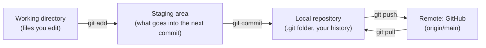

# 03 — Git and GitHub

## 1. The idea

**Git** is a time machine for a folder. It stores *snapshots* (commits) of your files, each with a message saying what changed and why. You can always see, compare or go back to any snapshot.

**GitHub** is a website that hosts a copy of your git repository, so it's backed up, shareable, and can trigger automation (next chapter).

The mental model, four places your changes move through:



The staging area is why git has two steps: you choose *exactly* what belongs together in one commit. A good commit is **one logical change**, with a message that says what it does (imperative, English: "Add Supabase config", not "added stuff").

`.gitignore` lists files git should never pick up (dependencies, build output, secrets). Important detail: **it only affects untracked files**. A file that's already committed stays tracked even if you add it to `.gitignore` later.

## 2. In our app

What Peer ran (21.10.2026), and the real history it produced:

```sh
git init -b main
git add .
git commit -m "Initial commit"
git remote add origin https://github.com/peerboku/wehrgasse.git
git push -u origin main
```

```
$ git remote -v
origin  https://github.com/peerboku/wehrgasse.git (fetch)
origin  https://github.com/peerboku/wehrgasse.git (push)

$ git log --stat
commit bf2f69c  (Wed Oct 21 11:54:45 2026 +0200)
    Add supabase config and Flatastic reference screenshots
 .gitignore           |   5 +-
 supabase/.gitignore  |   8 +
 supabase/config.toml | 415 +++++++
 3 files changed, 427 insertions(+), 1 deletion(-)

commit 7bdd65f  (Wed Oct 21 10:34:47 2026 +0200)
    Initial commit
 ... 20 files changed, 1777 insertions(+)

$ git status -sb
## main...origin/main [ahead 1]
```

Note what is **not** in the first commit's 20 files: `node_modules/`, `dist/`, `.env.local`. `.gitignore` worked.

### Lesson from the raw output: the message and the content disagree

Commit `bf2f69c` says *"…and Flatastic reference screenshots"*, but `--stat` lists no screenshots. They're excluded on purpose by a new `.gitignore` line, `docs/flatastic/screenshots`, which is a good call for a **public** repo, because they show flatmates' names and photos. But now the history lies about its content, and in a year nobody will trust it.

The habit that catches this: **read `git show --stat HEAD` after every commit, before pushing.**

Because this commit is **not pushed yet** (`ahead 1`), it's safe to fix:

```sh
git commit --amend -m "Add Supabase config; keep Flatastic screenshots local only"
git show --stat HEAD     # check: message now matches the files
git push
```

> ⚠️ `--amend` rewrites the last commit. Only do it **before** pushing. After a push, other copies already have the old commit; then you'd make a new commit instead.

(The same commit also changed one `.gitignore` line in a way that has a side effect, see [chapter 05](05-secrets-and-config.md).)

## 3. Predict, then run

1. Create an empty file: `touch test.txt`.
2. **Predict** the output of `git status` (which section will `test.txt` be in?). Run it.
3. `git add test.txt` → predict, then `git status` again.
4. Undo without committing: `git restore --staged test.txt && rm test.txt`.

## 4. What a pro would also do

- **Work on branches + pull requests** even alone (`git switch -c feature/login`): `main` always stays deployable, and the PR page shows the full diff plus the CI result *before* merging. We commit straight to `main` for now; worth adopting from Phase 3, when bugs can affect real data.
- **Protect `main`** in GitHub settings so CI must be green before merging.
- **Write messages that explain *why*** in the body when it isn't obvious from the diff:
  ```
  Keep Flatastic screenshots out of the repo

  The repo is public and the screenshots show flatmates' names and photos.
  ```

## 5. Sources

- *Pro Git* book, free, chapters 1–3 are enough for now: <https://git-scm.com/book/en/v2>
- `.gitignore` reference: <https://git-scm.com/docs/gitignore>
- `git commit --amend`: <https://git-scm.com/docs/git-commit#Documentation/git-commit.txt---amend>
- GitHub, "About remote repositories": <https://docs.github.com/en/get-started/getting-started-with-git/about-remote-repositories>

## 6. How we know it's right

- **GitHub itself** has the commit: the Actions run for "Initial commit" (next chapter) checked out exactly `7bdd65f` on a clean machine and built it.
- **`git status`** reports `ahead 1`. Git, not us, says the second commit isn't on GitHub yet.
- **`git log --stat`** is the evidence of what's in each commit; it caught the message mismatch above.

## 7. Check yourself

1. You add `secret.txt` to `.gitignore` *after* committing it. Is it now safe?
2. What does `ahead 1` mean, and what command changes it to "up to date"?
3. Why is `--amend` fine before `git push` but a problem after?

<details><summary>Answers</summary>

1. No. It's still tracked and still in the history (on GitHub too if pushed). You'd need `git rm --cached secret.txt`, and if it's a real secret, **rotate it** (create a new one), because the history still contains it.
2. Your local `main` has 1 commit that `origin/main` doesn't. `git push`.
3. Amend replaces the commit with a new one (new ID). Before pushing, only you have it. After pushing, GitHub has the old ID, and your next push is rejected as "diverged".

</details>

## 8. Your notes

> _Draw (on paper) where a file is after `git add` but before `git commit`:_
>
>
