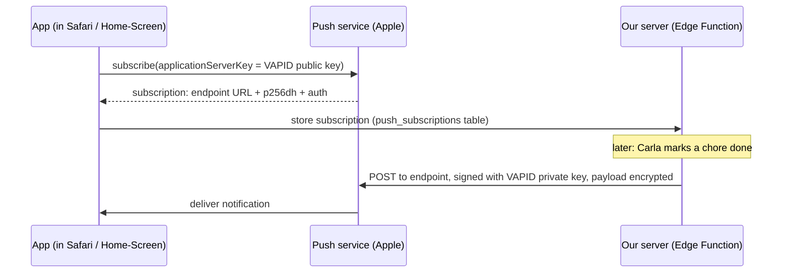

# 07 — Web Push and VAPID keys

## 1. The idea

A push notification on a phone isn't sent by your server *directly* to the phone. Phones only keep one connection open, to their platform's **push service** (Apple's for iPhones, Google's/Mozilla's for others). The flow, standardized in [RFC 8030](https://www.rfc-editor.org/rfc/rfc8030):



Two kinds of keys, two jobs:

- **VAPID key pair** ([RFC 8292](https://www.rfc-editor.org/rfc/rfc8292)) identifies *the sender*. The browser subscribes with the **public** key; the push service then only accepts messages for that subscription if they're signed with the matching **private** key. So someone who steals a subscription URL still can't spam you.
- **`p256dh` + `auth`** come *from the browser* in each subscription and are used to **encrypt** the message content ([RFC 8291](https://www.rfc-editor.org/rfc/rfc8291)), so Apple delivers it without being able to read it.

`VAPID_SUBJECT` is a contact (`mailto:` or URL) so the push service can reach the sender if something misbehaves.

iPhone specifics: Web Push works only for a web app **added to the Home Screen** (iOS/iPadOS 16.4+), and permission may only be requested **after a user tap**.

## 2. In our app

Peer generated the pair locally (so the private key never went through any chat):

```sh
npx web-push generate-vapid-keys
```

and stored it (timestamps from the CLIs, UTC):

| Key | Stored in | When |
|---|---|---|
| public | GitHub secret `VITE_VAPID_PUBLIC_KEY` + `.env.local` | 09:24:13 |
| private | Supabase secret `VAPID_PRIVATE_KEY` | 09:25:31 |
| subject | Supabase secret `VAPID_SUBJECT` | 09:25:31 |

Where they'll be used:

- **Phase 4, [src/lib/push.ts](../../src/lib/)**: `pushManager.subscribe({ userVisibleOnly: true, applicationServerKey: VAPID public key })`, then save the subscription to `push_subscriptions`.
- **Phase 4, `supabase/functions/notify-done`**: `webpush.setVapidDetails(subject, public, private)` and `webpush.sendNotification(subscription, payload)` for each of the other 3 members; on `404`/`410` the subscription is dead → delete the row.

## 3. Predict, then run

Run `npx web-push generate-vapid-keys` **once more** (don't save the result anywhere). **Predict** first: same keys as before, or different? What does that tell you about what would happen to existing subscriptions if you replaced the stored keys with these?

## 4. What a pro would also do

- **Treat the key pair as permanent.** Changing it invalidates every existing subscription; all 4 phones would have to re-enable notifications. Write that in the password-manager entry.
- **Log every send attempt** with the push service's HTTP status, which we plan as `push_sent` / `push_failed` events. Without that log, "I didn't get a notification" is undebuggable.
- **Test on the real target early.** Simulators and desktop browsers behave differently from iOS Home-Screen apps. The Phase 4 matrix (12/12 deliveries) is exactly this.

## 5. Sources

- RFC 8030, Generic Event Delivery Using HTTP Push: <https://www.rfc-editor.org/rfc/rfc8030>
- RFC 8292, VAPID: <https://www.rfc-editor.org/rfc/rfc8292>
- RFC 8291, Message Encryption for Web Push: <https://www.rfc-editor.org/rfc/rfc8291>
- MDN, Push API: <https://developer.mozilla.org/en-US/docs/Web/API/Push_API>
- WebKit blog, "Web Push for Web Apps on iOS and iPadOS": <https://webkit.org/blog/13878/web-push-for-web-apps-on-ios-and-ipados/>
- `web-push` library: <https://github.com/web-push-libs/web-push>

## 6. How we know it's right

- **Now**: `gh secret list` and `supabase secrets list` show all three names (see [chapter 05](05-secrets-and-config.md)).
- **Phase 4**: Apple's push service is the real judge. A `201` response means it accepted the signed message; `403` usually means the key pair doesn't match. The 12/12 matrix on four real iPhones is the final proof.

## 7. Check yourself

1. Which key does the browser get, and which one does Apple use to check our messages?
2. Can Apple read the text "✅ Carla hat Bad Carla & Peer erledigt"?
3. Why does a notification permission request on page load fail on iOS?

<details><summary>Answers</summary>

1. The browser gets the **public** key at subscribe time. Our function **signs** with the private key, and the push service verifies the signature against the public key bound to that subscription.
2. No. The payload is encrypted with the subscription's `p256dh`/`auth` keys; only the browser can decrypt it.
3. Safari only allows it as a direct response to a user gesture (a tap). That's why there's a "Benachrichtigungen aktivieren" button.

</details>

## 8. Your notes

> _Explain the difference between "signing" and "encrypting" with a real-world example:_
>
>
