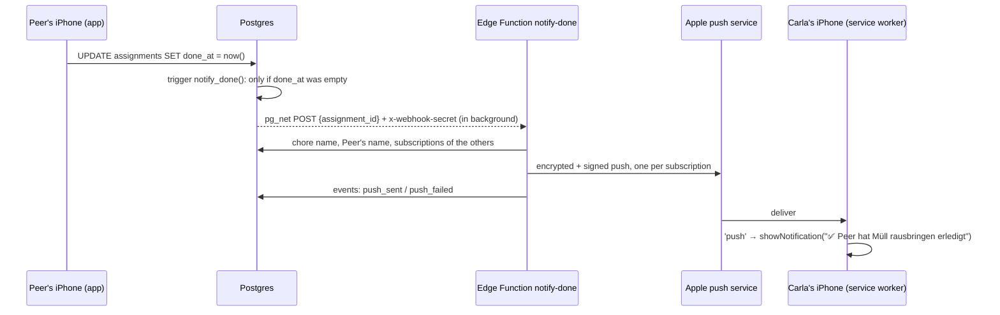

# 15 — Push notifications end to end: service worker, subscription, trigger, Edge Function

## 1. The idea

[Chapter 07](07-web-push-keys.md) explained the keys. This chapter connects the four parts that have to work together so that a tap on one phone makes a notification appear on three others:

1. **Subscribe (on each phone, once).** After a tap, the page asks for permission, then asks the browser's **push service** (Apple's, on an iPhone) for a *subscription*: a private address for this phone (`endpoint`) plus two encryption keys (`p256dh`, `auth`). The page stores that in our database.
2. **Trigger (in the database).** When a row changes in a certain way, a **trigger** runs a function *inside* Postgres. Ours sends an HTTP request with the extension `pg_net`. That request is queued and sent in the background, so the original `UPDATE` doesn't wait for it.
3. **Send (on the server).** An **Edge Function** is a small program Supabase runs for us on request (in Deno, a JavaScript runtime). It looks up who should get the message, encrypts it for each subscription, signs it with the VAPID private key, and POSTs it to each `endpoint`.
4. **Show (on the receiving phone).** The phone wakes up the app's **service worker** (the background script from [chapter 11](11-pwa-install-on-iphone.md)) with a `push` event. The service worker *must* show a notification. A tap on the notification fires `notificationclick`, which opens the app.



Two rules that iOS enforces and that shaped the code:
- Permission can only be asked **in response to a tap**, and only in the **Home-Screen app** (iOS 16.4+). In plain Safari, `PushManager` doesn't even exist.
- Every push must lead to a visible notification (`userVisibleOnly: true`). Safari revokes the subscription after a few "silent" pushes.

## 2. In our app

| File | Job |
|---|---|
| [`src/lib/push.ts`](../../src/lib/push.ts) | `pushSupported`, `isPushOn`, `enablePush`, `disablePush` (browser side) |
| [`src/lib/data.ts`](../../src/lib/data.ts) | `savePushSubscription`, `deletePushSubscription` (database side) |
| [`src/screens/Settings.tsx`](../../src/screens/Settings.tsx) | the switch, now real; hints for "blocked" and "didn't work" |
| [`src/sw.ts`](../../src/sw.ts) | `push` → `showNotification`, `notificationclick` → focus or open the app |
| [`supabase/migrations/20261027150000_push_webhook.sql`](../../supabase/migrations/20261027150000_push_webhook.sql) | grants for `service_role`, `pg_net`, trigger `notify_done` |
| [`supabase/functions/notify-done/index.ts`](../../supabase/functions/notify-done/index.ts) | the sender, logs `push_sent` / `push_failed`, deletes dead subscriptions (404/410) |
| [`supabase/config.toml`](../../supabase/config.toml) | `[functions.notify-done] verify_jwt = false` |

Why a trigger in a migration and a shared secret instead of a dashboard webhook and a JWT: [ADR 0009](../decisions/0009-push-trigger-pg-net-vault.md).

Details worth knowing:
- **Save = delete, then insert.** `endpoint` is unique. The same phone can subscribe again, maybe under another name, so `savePushSubscription` first removes the old row. Our grants allow `insert` and `delete` on `push_subscriptions`, but not `update`.
- **Logout turns push off** on that phone. Otherwise a phone that switches from "Peer" to "Carla" would keep getting Peer's notifications.
- **The notification text lives in the function**, not in `strings.ts`, because the function runs on Supabase and can't import app files.
- **Events from the function** use `member_id` = the *recipient*, so "did Manu ever receive anything?" is one query.

**Mistake caught before it happened: `service_role` couldn't read anything.** The Edge Function logs in as `service_role`. The lesson from chapter 13 was "never rely on default privileges", so we asked the database first:
```
$ supabase db query --linked "select table_name, string_agg(privilege_type, ',') from information_schema.role_table_grants where grantee = 'service_role' and table_schema = 'public' group by 1"
assignments         REFERENCES,TRIGGER,TRUNCATE
chores              REFERENCES,TRIGGER,TRUNCATE
events              REFERENCES,TRIGGER,TRUNCATE
…
```
No `SELECT`. `service_role` skips RLS, but **grants are checked before RLS**, so the function would have died with "permission denied". The migration grants exactly what it needs: read members/chores/assignments/subscriptions, delete subscriptions, insert events.

**Dry run before pushing** (27.10., everything inside `begin … rollback`, so nothing stayed in the DB):

1. Migration + grants, as `service_role`:
   ```
   members_readable: 4   assignments_readable: 4   subs_readable: 0
   can_update_assignments: false   can_delete_events: false   can_insert_events: true
   ```
   With no Vault values yet, a chore could still be marked done, and `queued_requests: 0`. The trigger just skipped.
2. With dummy Vault values, marking done **as the WG user** (`set local role authenticated`), then setting `done_at` again on rows that were already done:
   ```
   url: https://example.invalid/notify-done   secret_header: dummy   queued: 1
   body: \x7b2261737369676e6d656e745f6964223a2022…   ← hex for {"assignment_id": "23d4444a-…"}
   ```
   Exactly one request: the second update didn't fire, thanks to `when (old.done_at is null …)`.

⏳ **Deploy, first real push, and the 4-iPhone matrix:** to be filled in from the real output.

### Setup checklist (done once by Peer)
Values are created and stored in the terminal, so they never appear in a chat or in git.
1. VAPID public key for the function (it's public, but `web-push` needs it next to the private one):
   `supabase secrets set VAPID_PUBLIC_KEY="$(grep '^VITE_VAPID_PUBLIC_KEY=' .env.local | cut -d= -f2-)"`
2. `VAPID_SUBJECT` must start with `mailto:` (or `https://`); Apple answers `403 BadJwtToken` otherwise.
3. Shared secret, stored in both places:
   ```sh
   SECRET=$(openssl rand -hex 32)
   supabase secrets set NOTIFY_DONE_SECRET="$SECRET"
   supabase db query --linked "select vault.create_secret('$SECRET', 'notify_done_secret')"
   unset SECRET
   ```
4. Function URL in Vault:
   `supabase db query --linked "select vault.create_secret('$(grep '^VITE_SUPABASE_URL=' .env.local | cut -d= -f2-)/functions/v1/notify-done', 'notify_done_url')"`
5. `supabase db push`, then `supabase functions deploy notify-done`.

## 3. Predict, then run

After the deploy, call the function from your laptop **without** the secret:
```
curl -i -X POST "$(grep '^VITE_SUPABASE_URL=' .env.local | cut -d= -f2-)/functions/v1/notify-done" -d '{}'
```
**Predict** the status code before you run it. Then predict: would it be different if `verify_jwt` were still `true`? Which part answers in each case, Supabase's gateway or our code?

## 4. What a pro would also do

- **Retry failed sends** (e.g. Apple answers 5xx) with a queue, instead of logging `push_failed` and giving up.
- **Rotate the shared secret** on a schedule, and compare it in constant time (`timingSafeEqual`) to rule out timing attacks. Overkill for 4 people.
- **A "Test senden" button** in Settings that pushes only to your own phone. Saved as an idea in ROADMAP.
- **Monitor** `push_failed` per member, and alert when someone's last `push_sent` is weeks old.

## 5. Sources

- MDN, Push API and `PushManager.subscribe()`: <https://developer.mozilla.org/en-US/docs/Web/API/PushManager/subscribe>
- MDN, `ServiceWorkerRegistration.showNotification()` and `notificationclick`: <https://developer.mozilla.org/en-US/docs/Web/API/ServiceWorkerRegistration/showNotification>
- WebKit blog, Web Push for Web Apps on iOS and iPadOS: <https://webkit.org/blog/13878/web-push-for-web-apps-on-ios-and-ipados/>
- Apple, Sending web push notifications in web apps and browsers: <https://developer.apple.com/documentation/usernotifications/sending-web-push-notifications-in-web-apps-and-browsers>
- Supabase, pg_net: <https://supabase.com/docs/guides/database/extensions/pg_net>
- Supabase, Vault: <https://supabase.com/docs/guides/database/vault>
- Supabase, Edge Functions and function configuration (`verify_jwt`): <https://supabase.com/docs/guides/functions>
- PostgreSQL 17, `CREATE TRIGGER` (the `WHEN` condition): <https://www.postgresql.org/docs/17/sql-createtrigger.html>
- `web-push` library: <https://github.com/web-push-libs/web-push>

## 6. How we know it's right

- **The database itself** answered the dry run: the grants match, the trigger fires once and only on "open → done".
- ⏳ **Apple** is the judge for the rest: `push_sent` events with status `201`, and `net._http_response` showing `200` from our function.
- ⏳ **Other people, on their own phones:** the 12/12 matrix (each member marks a chore done, the other 3 confirm they got it).

## 7. Check yourself

1. Why does the trigger have a `WHEN (old.done_at is null and new.done_at is not null)` and not just `after update`?
2. Carla deletes the app from her Home Screen. What happens the next time someone marks a chore done?
3. Why can't the function just import the German text from `src/lib/strings.ts`?

<details><summary>Answers</summary>

1. Any other update (e.g. Peer swapping `member_id` in the dashboard, or an accidental second "done") would send a push too.
2. Apple answers `410 Gone` for her subscription. The function logs `push_failed` with status 410 and deletes the row. She has to turn notifications on again after reinstalling.
3. The function is deployed and runs on Supabase's servers, in Deno, not in the browser. Supabase expects function code inside `supabase/functions/` (shared code goes in `supabase/functions/_shared/`). `strings.ts` belongs to the app's Vite build and pulls in `week.ts` too. One sentence of duplicated text is simpler than sharing code between two runtimes.

</details>

## 8. Your notes

> _Draw the path of one notification from your thumb to Carla's lock screen, with every place where it could get lost:_
>
>
