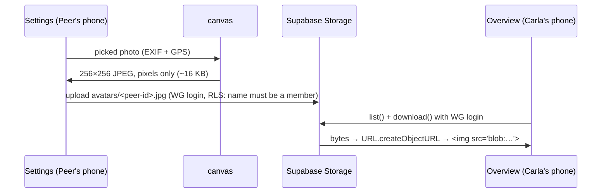

# 16 — Private photos: Storage buckets, RLS on files, and stripping GPS

## 1. The idea

A database stores rows; **object storage** stores files (photos, PDFs). Supabase Storage keeps files in **buckets**. Under the hood every file is a row in the Postgres table `storage.objects` (columns like `bucket_id`, `name`, `owner`), and the actual bytes sit in an S3-like store. Because files are rows, **the same Row Level Security as in [chapter 13](13-schema-rls-migrations-cron.md) decides who may read, upload, replace or delete them**.

A bucket is either:
- **public**: anyone with the URL `…/object/public/<bucket>/<file>` gets the file, no login. Fine for logos, wrong for faces.
- **private**: every request must pass RLS. To show the file you either
  - make a **signed URL** (a link with a secret token that works *for anyone* until it expires), or
  - **download** it with your login and show it from an **object URL** (`blob:…`), an address the browser invents that only works inside the tab that created it.

Second idea: **photos carry hidden data.** An iPhone JPEG/HEIC contains **EXIF** metadata: GPS coordinates, phone model, date. Upload the original and you upload where it was taken (often: home). If you draw the image onto a `<canvas>` and save the canvas as a new JPEG, only the pixels survive: the EXIF block is gone.



## 2. In our app

| File | Job |
|---|---|
| [`supabase/migrations/20261027170000_avatar_photos.sql`](../../supabase/migrations/20261027170000_avatar_photos.sql) | private bucket `avatars` (512 KB, JPEG only) + 4 policies on `storage.objects` |
| [`src/lib/photos.ts`](../../src/lib/photos.ts) | `resizePhoto` (crop, 256×256, re-encode = EXIF gone), `PhotosContext` |
| [`src/lib/data.ts`](../../src/lib/data.ts) | `loadPhotos` (list + download → object URLs), `savePhoto`, `deletePhoto` |
| [`src/components/Avatar.tsx`](../../src/components/Avatar.tsx) | photo if there is one, otherwise the emoji |
| [`src/App.tsx`](../../src/App.tsx) | holds the photos, `handlePhotoChange`, frees old object URLs, logs `avatar_changed` |
| [`src/screens/Settings.tsx`](../../src/screens/Settings.tsx) | "Foto hinzufügen 📸" / "Foto ändern" / "Foto entfernen" |

Why this design: [ADR 0010](../decisions/0010-private-avatar-bucket.md). Short version: the repo and the Pages site are public, so photos must sit behind the WG login, and `download()` creates no link that bypasses it.

**New React idea: Context.** Three screens show `Avatar`. Instead of passing `photos` as a prop through each screen, `App.tsx` wraps everything in `<PhotosContext.Provider value={photos}>` and `Avatar` reads it with `useContext(PhotosContext)`. Context is for data that "everything below" needs; for normal parent→child data, props stay simpler.

**The policies** (excerpt). `storage.objects` holds files of *all* buckets, so every rule starts with `bucket_id = 'avatars'`. Upload is limited to the 4 names `<member_id>.jpg`:

```sql
create policy "wg can add avatars" on storage.objects for insert to authenticated
  with check (bucket_id = 'avatars' and name in (select id::text || '.jpg' from public.members));
```

**Pushing it** (27.10.):

```
$ supabase db push
Applying migration 20261027170000_avatar_photos.sql...
{"upToDate":false,"dryRun":false,"migrations":["20261027170000_avatar_photos.sql"], ... "message":"Finished supabase db push."}
```

The database confirms the bucket settings:

```
$ supabase db query --linked "select id, public, file_size_limit, allowed_mime_types from storage.buckets where id = 'avatars'"
  "allowed_mime_types": ["image/jpeg"], "file_size_limit": 524288, "id": "avatars", "public": false
```

**Attacking it from outside** with only the public anon key (it's in our JavaScript, so assume everyone has it), against Peer's real file `c3825cc5-….jpg`:

```
1) public link:                {"error":"Bucket not found","code":"NoSuchBucket"}                         [HTTP 400]
2) download, anon key only:    {"error":"not_found","message":"Object not found","code":"NoSuchKey"}      [HTTP 400]
3) list, anon key only:        []                                                                          [HTTP 200]
4) overwrite, anon key only:   {"message":"new row violates row-level security policy"}                    [HTTP 400]
5) delete, anon key only:      {"message":"Access denied"}                                                 [HTTP 400]
```

Notice how RLS answers: not "forbidden" but "not found" and an empty list. For anon, the file simply doesn't exist. That's on purpose: it doesn't even reveal *that* a photo is there.

**Mistake worth remembering:** I ran checks 2 and 3 *before* any photo was uploaded. "Object not found" and `[]` were true, but proved nothing: the bucket was empty! Only re-running them after Peer uploaded a real photo made them evidence. A security test needs something there to protect.

**Wrong file name, as the logged-in role**, inside a transaction that is rolled back (nothing stays):

```
$ supabase db query --linked "begin; set local role authenticated; insert into storage.objects (bucket_id, name) values ('avatars', 'evil.jpg'); rollback;"
ERROR:  42501: new row violates row-level security policy for table "objects"

$ ... same with Carla's id ... returning name;
  "name": "f6130aa3-727f-4be2-b7fd-f7e530c32ccb.jpg"     ← allowed, then rolled back
```

Afterwards `supabase storage ls ss:///avatars/ --experimental --linked` still showed only Peer's file, so the rollback worked.

**Is the GPS really gone?** Downloaded the stored file (the CLI uses the service role, which skips RLS, fine for an admin check):

```
$ file stored.jpg
JPEG image data, JFIF standard 1.01, ... 256x256, components 3
$ grep -c -a -E "Exif|GPS|Apple|iPhone" stored.jpg
0
$ xxd stored.jpg | head -2
00000000: ffd8 ffe0 0010 4a46 4946 ...  ......JFIF......
00000010: 0001 0000 ffe2 01d8 4943 435f 5052 4f46  ........ICC_PROF
```

A JPEG starts with `ffd8`. An iPhone original continues with `ffe1` + `Exif` (the metadata block). Ours goes `ffe0` `JFIF` (plain header) and `ffe2` `ICC_PROFILE` (colour profile, harmless). 16 643 bytes. No EXIF, no GPS.

**And it's logged:**

```
"created_at": "2026-10-27 01:02:35+00", "name": "Peer", "type": "avatar_changed", "payload": {"removed": false}
```

## 3. Predict, then run

Write down what you expect, *then* run it (with your real anon key and URL from `.env`):

```sh
curl -s "$VITE_SUPABASE_URL/storage/v1/object/public/avatars/c3825cc5-c900-41c8-8aa7-e2c6fd33d538.jpg"
```

Now imagine the migration had said `public = true`. What would this command return, and who in the world could run it?

## 4. What a pro would also do

- **One login per person** so the DB itself enforces "only change your own photo" (`owner = auth.uid()`). We gave that up on purpose in ADR 0007.
- **Cache photos offline** (IndexedDB, or the service worker) so they show without network. Not worth it for 4 × 16 KB.
- **Image transformations** on the server (Supabase can resize on request, on paid plans). Doing it on the phone is free and also strips GPS *before* the upload.

## 5. Sources

- Supabase: [Storage access control](https://supabase.com/docs/guides/storage/security/access-control) (policies on `storage.objects`, which operations need which policy)
- Supabase: [Storage buckets: public vs private](https://supabase.com/docs/guides/storage/buckets/fundamentals)
- MDN: [`URL.createObjectURL()`](https://developer.mozilla.org/en-US/docs/Web/API/URL/createObjectURL_static), [`HTMLCanvasElement.toBlob()`](https://developer.mozilla.org/en-US/docs/Web/API/HTMLCanvasElement/toBlob), [`HTMLImageElement.decode()`](https://developer.mozilla.org/en-US/docs/Web/API/HTMLImageElement/decode)
- React: [`useContext`](https://react.dev/reference/react/useContext)
- JPEG markers: [JFIF spec (ITU-T T.871)](https://www.itu.int/rec/T-REC-T.871), EXIF lives in the APP1 (`ffe1`) segment.

## 6. How we know it's right

- **Supabase Storage itself** rejected anon on all five operations against a real file, and Postgres rejected a wrong file name for the logged-in role (`42501`).
- **The file on the server** has no EXIF segment (`file`, byte dump, `grep`).
- **The database** shows the bucket as `public: false` and the `avatar_changed` event.
- Peer saw the photo in Settings, WG and on the name tiles in `npm run dev`.
- ⏳ **"Foto entfernen"** → emoji back, `avatar_changed` with `removed: true`.
- ⏳ **On the iPhone** (Home-Screen app): pick from library + take with camera; a second phone shows the photo after reopening.

## 7. Check yourself

1. Check 3 (list with anon key) returned `[]` and HTTP 200, not an error. Why is that still a pass?
2. Why is a signed URL less private than `download()`, even if it expires after an hour?
3. Carla picks a photo taken in her room. Where does its GPS location end up?

<details><summary>Answers</summary>

1. RLS filters rows instead of failing the query: anon is allowed to *ask*, but sees zero rows. An empty list for a bucket that we know contains a file is exactly "you see nothing".
2. Whoever gets the link (forwarded, copied from a screenshot of dev tools, in a log) sees the photo without the WG password, for the whole hour. An object URL only works inside the app tab that downloaded it.
3. Nowhere outside her phone: `resizePhoto` draws it on a canvas and saves a new JPEG with pixels only, before anything is uploaded.

</details>

## 8. Your notes

> _Explain to Noa, in two sentences, why her photo is safe even though the app's code is public:_
>
>
