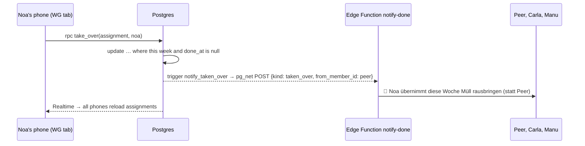

# 17 — Take over a chore: database functions (RPC) and a second push type

## 1. The idea

So far the app changed data in two ways: **insert** a row (events, push subscriptions) or **update** a column the role is allowed to touch (`done_at`, `done_by`). Grants and RLS answer "*which columns* and *which rows*". Some rules can't be written that way well. "You may change `member_id`, but only on this week's row, and only while it's still open" depends on the row's *other* columns and on today's date in Vienna.

For that, Postgres has **functions**, and Supabase exposes them over HTTP as **RPC** (remote procedure call): `supabase.rpc('take_over', { … })` runs `select public.take_over(…)` on the server.

- **`security definer`**: the function runs with the rights of its **owner** (the migration's user), not of the caller. So the caller needs *no* update right on the table, only `execute` on the function. The function body becomes the one door: whatever the `where` clause allows, nothing else.
- Because it's that powerful, the next lines matter as much as the function itself: **`revoke execute … from public, anon`** (by default *everyone* may run a new function) and **`grant execute … to authenticated`**.
- **`set search_path = public`**: inside a `security definer` function, never let the caller choose where table names are looked up.

Second idea: **one trigger per event, one Edge Function for both.** A trigger can fire on `update of member_id` the same way the old one fires on `update of done_at`. The request body gets a `kind` field, so `notify-done` knows which text to send.



## 2. In our app

| File | Job |
|---|---|
| [`supabase/migrations/20261027180000_take_over.sql`](../../supabase/migrations/20261027180000_take_over.sql) | `take_over()` (security definer, execute for `authenticated`), `notify_taken_over()` + trigger |
| [`supabase/functions/notify-done/index.ts`](../../supabase/functions/notify-done/index.ts) | reads `kind` (`'done'` if missing), `takenOverText`, `notifyAllExcept`; `kind` in the `push_*` event payload |
| [`src/lib/data.ts`](../../src/lib/data.ts) | `takeOver()` → `supabase.rpc('take_over', …)` |
| [`src/screens/Overview.tsx`](../../src/screens/Overview.tsx) | open rows of others this week are a `<button>` with `›`, open the `ConfirmSheet` |
| [`src/components/ConfirmSheet.tsx`](../../src/components/ConfirmSheet.tsx) | now gets `question`, `hint`, `yesLabel` as props, so it serves "erledigt?" and "übernehmen?" |
| [`src/App.tsx`](../../src/App.tsx) | `handleTakeOver`: shows it as mine right away, calls `takeOver`, logs `assignment_swapped` |
| [`src/screens/MyWeek.tsx`](../../src/screens/MyWeek.tsx) | `thisWeek` is now a list: one big card per chore (two after a take-over) |

Why a function and not a column grant, and why a second trigger: [ADR 0011](../decisions/0011-take-over-via-function.md).

**The rule, in one `where` clause:**

```sql
update assignments
set member_id = p_member_id
where id = p_assignment_id
  and week_start = this_monday      -- Monday of now, in Europe/Vienna
  and done_at is null               -- still open
  and member_id <> p_member_id;     -- not already yours

if not found then
  raise exception 'take_over: not an open assignment of this week';
end if;
```

`found` is a variable that plpgsql sets after each statement: true if the `update` changed at least one row. If not, `raise exception` turns into an error in the app (`error` from `rpc`), and `handleTakeOver` shows "Das hat nicht geklappt …" and reloads.

**Why the rotation doesn't change:** `take_over` touches one row in `assignments`. `rotation_template` is never touched. Next Monday `ensure_week()` builds the new rows from the template as always.

**A small HTML rule we hit:** the tappable row is a `<button>`, and a `<button>` may only contain *inline* elements. The row used `<p>` (a block element). So the `<p>`s in the row became `<span>`s with `display: block` in the CSS: same look, valid HTML.

**Pushing it:** ⏳ Peer runs this. Paste the real output here:

```
$ supabase db push
(output)

$ supabase functions deploy notify-done
(output)
```

## 3. Predict, then run

In the dashboard SQL editor, pick a row of **last week** (or one that is already done) and try to take it over:

```sql
select public.take_over('<assignment id>', '<your member id>');
```

Write down first: error or success? If error, which text? Then run it. Then think: what would happen with `grant update (member_id) on assignments to authenticated` instead of the function, if the app sent the same request?

## 4. What a pro would also do

- **Test the function with pgTAP** (SQL unit tests: "done row → raises", "open row → member_id changed"). For 10 lines of SQL we test by hand in the SQL editor instead.
- **Generate types** for `rpc` calls (`supabase gen types typescript`), so a typo in `p_assignment_id` is a compile error. Today it would only fail at runtime.
- **One helper for the Vault lookup**, used by both trigger functions. Two copies are still readable; at three, refactor.

## 5. Sources

- PostgreSQL: [`CREATE FUNCTION`](https://www.postgresql.org/docs/current/sql-createfunction.html) (`SECURITY DEFINER`, "Writing SECURITY DEFINER Functions Safely" → `search_path`)
- PostgreSQL: [PL/pgSQL: obtaining the result status (`FOUND`)](https://www.postgresql.org/docs/current/plpgsql-statements.html#PLPGSQL-STATEMENTS-DIAGNOSTICS)
- PostgreSQL: [`CREATE TRIGGER`](https://www.postgresql.org/docs/current/sql-createtrigger.html) (`UPDATE OF column`, `WHEN`, `IS DISTINCT FROM`)
- Supabase: [Database functions](https://supabase.com/docs/guides/database/functions) and [`rpc()`](https://supabase.com/docs/reference/javascript/rpc)
- HTML spec: [the `button` element](https://html.spec.whatwg.org/multipage/form-elements.html#the-button-element) (content model: phrasing content)

## 6. How we know it's right

- **Machines, before deploy (27.10.):** `npm run lint` (no findings), `npm run test` (20/20 passed, week logic unchanged), `npm run build` (OK, `dist/sw.js` generated). The Edge Function is not type-checked locally (no Deno installed); `supabase functions deploy` bundles it and would fail on syntax errors.
- ⏳ **The database refuses:** `take_over` on a done row and on a last-week row → `take_over: not an open assignment of this week`.
- ⏳ **The database accepts:** an open row of this week → `member_id` changed; `net._http_response` shows status 200 for the push request.
- ⏳ **On the iPhones:** the other phones get "🔄 … übernimmt …", the old owner too, the new owner not. "Meine Woche" of the new owner shows two cards.
- ⏳ **Events:** `assignment_swapped` with `from_member_id`; `push_sent` with `kind: "taken_over"`.

## 7. Check yourself

1. Why does the app need `execute` on `take_over` but *no* `update` right on `member_id`?
2. Noa takes over Peer's chore. Who gets a push, and why does Peer get one even though he didn't do anything?
3. Next Monday: whose chore is it then, and which table decides that?

<details><summary>Answers</summary>

1. `security definer`: the function runs with its owner's rights, so the update inside it is allowed. The caller only needs permission to *call* it, and the `where` clause limits what the call can do.
2. Everyone except Noa (Peer, Carla, Manu). The push is sent to all except the *new* `member_id`. Peer must know he's off the hook, otherwise he might do it too.
3. `ensure_week()` builds next week from `rotation_template`, which `take_over` never changes. So it's whoever the 4-week cycle says, not Noa.

</details>

## 8. Your notes

> _Explain to Manu, in two sentences, what happens when he taps "Ja, mach ich!" on Carla's chore:_
>
>
