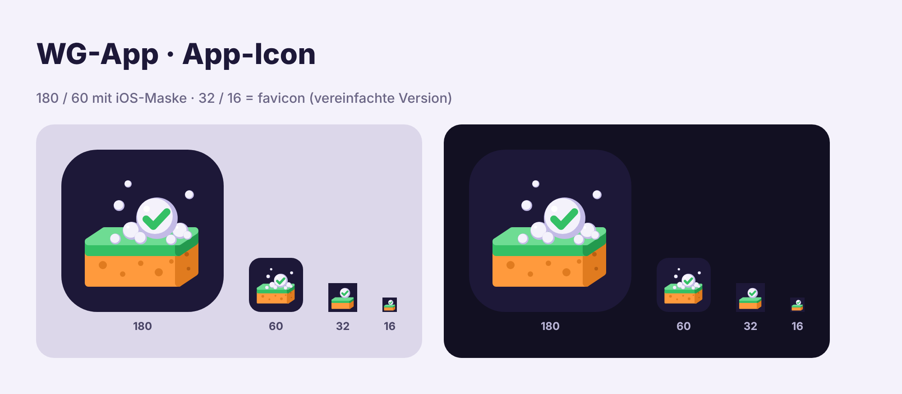

# Handoff: New app icon for "WG-App"

Replace the old icon (green rounded square, white house with check mark) with the new one: an orange kitchen sponge with a green scrub layer, foam bubbles and a "done" bubble with a green check, on dark purple.



## Files

| File | Size | Use |
|---|---|---|
| `icon.svg` | 180×180 viewBox | Master artwork (source of truth). Full bleed, no transparency. |
| `apple-touch-icon.png` | 180×180 | iOS Home Screen icon |
| `icon-192.png` | 192×192 | Web manifest, purpose `any` |
| `icon-512.png` | 512×512 | Web manifest, purpose `any` |
| `icon-maskable.svg` / `icon-maskable-512.png` | 512×512 | Web manifest, purpose `maskable` (artwork scaled to 80 % to stay inside the safe zone) |
| `favicon.svg` | 180×180 viewBox | Browser tab icon. **Simplified version** (bigger sponge, no pores, only the check bubble) so it holds up at 16 px |
| `favicon-32.png`, `favicon-16.png` | 32×32, 16×16 | PNG favicon fallbacks (rendered from `favicon.svg`) |
| `preview.png` | – | All sizes on light and dark backgrounds, for reference only (do not ship) |
| `render_icons.py` | – | Optional: regenerates all PNGs from the SVGs (needs Python + Playwright/Chromium) |

## Tasks for implementation

1. Copy the icon files into the app's public/static root (where the current icon files live). Keep the file names unless the project already uses different ones; then overwrite those instead.
2. Delete the old house icon files and any references to them.
3. Update `<head>` (all pages / the app shell):

   ```html
   <link rel="icon" href="/favicon.svg" type="image/svg+xml">
   <link rel="icon" href="/favicon-32.png" sizes="32x32" type="image/png">
   <link rel="icon" href="/favicon-16.png" sizes="16x16" type="image/png">
   <link rel="apple-touch-icon" href="/apple-touch-icon.png">
   ```

   Adjust paths to the project's public folder. Remove old `icon` / `apple-touch-icon` links.
4. Update the web manifest `icons` array (create `manifest.webmanifest` only if the project already uses one or needs one for the PWA):

   ```json
   "icons": [
     { "src": "/icon-192.png", "sizes": "192x192", "type": "image/png", "purpose": "any" },
     { "src": "/icon-512.png", "sizes": "512x512", "type": "image/png", "purpose": "any" },
     { "src": "/icon-maskable-512.png", "sizes": "512x512", "type": "image/png", "purpose": "maskable" }
   ]
   ```

5. If a service worker precaches assets: add the new files, remove the old ones and bump the cache version so clients pick them up.
6. Bump any asset version/query string used for icons (e.g. `?v=2`) to bust caches.

## Notes

- **Do not** add rounded corners or transparency to the PNGs. iOS applies its own mask.
- iOS caches Home Screen icons. To see the new icon, each flatmate has to remove the web app from the Home Screen and add it again via Safari › Share › "Zum Home-Bildschirm".
- Do not edit the PNGs by hand. Change the SVG and re-run `render_icons.py`.

## Colours used

| Token | Hex |
|---|---|
| Background (ink) | `#1D1838` |
| Sponge front / side / pores | `#FF9A3D` / `#E07B1F` / `#B85F12` |
| Scrub layer top / front / side | `#6EDC93` / `#34C065` / `#239A4E` |
| Bubble light / shade / shine | `#F4F2FB` / `#C3BBE6` / `#FFFFFF` |
| Check | `#34C065` (= app "done" green) |
